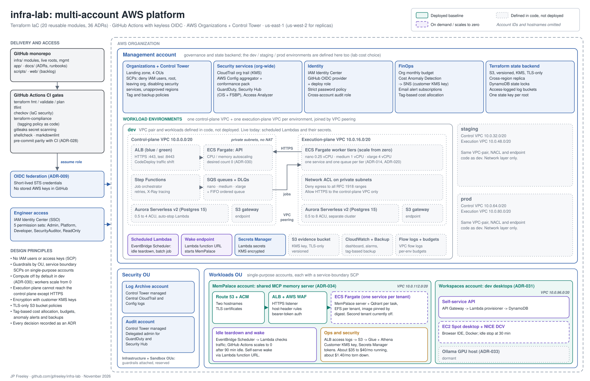

# infra-lab

Monorepo with clear boundaries:

- `infra/` — Terraform/IaC (multi-account, multi-environment)
- `app/` — application code
- `docs/` — documentation, ADRs, runbooks
- `scripts/` — automation scripts
- `web/` — Jira-ready agile backlog (HTML)

## AWS Accounts

| Account | ID | Purpose |
| --- | --- | --- |
| Management | `551452024305` | Organizations, Control Tower, state backend, dev / staging / prod VPCs |
| MemPalace | `310697203282` | Shared MemPalace MCP server (ECS Fargate + Qdrant) |
| Workspaces | `815802018602` | Remote dev desktops (EC2 + NICE DCV) |



Full-size PDF: [docs/diagrams/infra-lab-architecture.pdf](docs/diagrams/infra-lab-architecture.pdf).

## Quick Start — Dev Desktop

The workspaces account provides a remote graphical desktop for development:

```bash
# Get the current IP
cd infra/live/workspaces
terraform output dcv_connect_url
```

Connect via browser, then start the dev stack:

```bash
newgrp docker
supabase start
cd ~/development && docker compose up -d
```

See [docs/runbooks/workspaces-operations.md](docs/runbooks/workspaces-operations.md) for full details.

## Documentation

- [Architecture Overview](docs/architecture.md)
- [Networking CIDR Plan](docs/networking-cidr-plan.md)
- [ADRs](docs/adr/)
- [Runbooks](docs/runbooks/)

Architecture notes and the agile backlog: [lintwiselabs.com/infra_lab/](https://lintwiselabs.com/infra_lab/platform_architecture.html)
