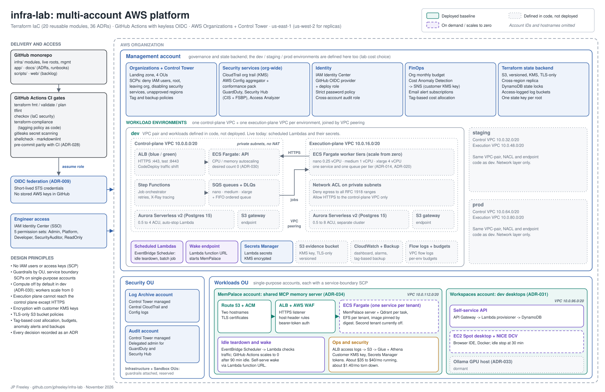

# Architecture Overview

This document describes the architecture of the `infra-lab` project as the code
defines it today. The original target design (March 2026) lives in the
[architecture notes](https://lintwiselabs.com/infra_lab/platform_architecture.html);
the "As built" section there lists where the code differs from that design.

PDF for printing or sharing: [infra-lab-architecture.pdf](diagrams/infra-lab-architecture.pdf).
The diagram is generated by [`scripts/diagrams/architecture.py`](../scripts/diagrams/architecture.py);
see its docstring for the render commands.

## Components

- **Infra**: Terraform-managed AWS resources (`infra/`), 20 reusable modules.
- **App**: Containerized application code (`app/`).
- **Docs**: ADRs, runbooks, the network plan and this diagram (`docs/`).

## Accounts

| Account | ID | Purpose |
| --- | --- | --- |
| Management | `551452024305` | AWS Organizations, Control Tower, SCPs, state backend; also hosts the dev / staging / prod VPCs (cost choice) |
| Log Archive | Control Tower managed | Central CloudTrail and Config logs |
| Audit | Control Tower managed | Delegated admin for GuardDuty and Security Hub |
| MemPalace | `310697203282` | Shared MemPalace MCP server (ECS Fargate + Qdrant), see ADR-034 |
| Workspaces | `815802018602` | Remote dev desktops (EC2 Spot + NICE DCV), see ADR-031 |

The MemPalace and Workspaces accounts sit in the Workloads OU, each with a
service-boundary SCP that allows only the services that account uses.

## Deployment state

Checked against Terraform state on 2026-11-12.

| Area | State |
| --- | --- |
| Organization, SCPs, security services, state backend | Deployed |
| dev | Only the scheduled Lambdas (MemPalace idle teardown and wake, a batch job), their EventBridge schedules, an S3 bucket and secrets are deployed. The VPC pair, ECS, SQS, Step Functions, Aurora, CloudWatch and Backup resources are defined but not deployed. |
| staging, prod | Network layer defined (VPC pair, NACLs, S3 endpoints), not deployed |
| MemPalace | Deployed (one tenant service running; the second tenant's service is off); the stack is torn down automatically after 90 minutes idle |
| Workspaces | Self-service API deployed; desktops started on demand; Ollama GPU host dormant (ADR-033) |

## Dev Desktop (Workspaces Account)

The workspaces account hosts EC2 Spot instances running NICE DCV for remote
graphical development. Key characteristics:

- Golden AMI (`ami-0f618edd4b848eb44`) with Docker, Supabase CLI, Git
- Persistent 50GB EBS data volume for repos, Docker images, and user state
- Docker-based dev stack: Python 3.11, Node 20, code-server, Supabase local
- Spot instance (t3.large, one-time request) for cost optimization (~$28/mo vs $140/mo for WorkSpaces)
- Idle auto-stop after 30 min of inactivity; terminate to fully decommission
- Service boundary SCP restricts allowed AWS services
