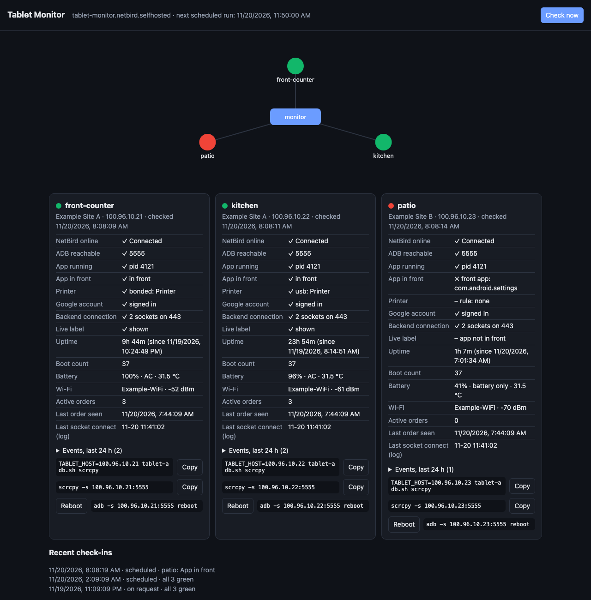

# Tablet Monitoring

The tablet monitor checks every tablet four times a day, shows the result on
a status page inside the NetBird network, and sends a push message (ntfy)
when a tablet is red. Design: [ADR-038](../../adr/038-netbird-tablet-monitor.md).
Code: `infra/modules/tablet_monitor/files/monitor.py`.

## The daily rhythm

| Time (New York) | What happens |
| --- | --- |
| about 05:20 to 05:35 | The lease workflow sees the 06:00 window open and brings the server up (about 6 minutes), then starts the monitor. ntfy: **Tablet monitor up** "Up for the 06:00 check-in." (low priority). |
| 05:35 to 05:50 | Tablets reconnect to the server. Clients back off while the server is away, so this can take up to about 8 minutes. |
| 05:50 | Check-in run 1. |
| 06:00 | Check-in run 2, then the verdict. ntfy **only if a tablet is red**. |
| 06:15 to 06:30 | The next lease check finds the window closed: the monitor stops (ntfy: **Tablet monitor down** with the last result, low priority) and the server is torn down. |

The same happens for 12:00, 18:00 and 00:00. Between windows nothing runs
and nothing is reachable.

## What turns a tablet red

A tablet is **red** only when the **same check fails in both runs**, 10
minutes apart. A tablet that is still reconnecting, or that someone is
using on another screen for a minute, passes on the second run and does not
alert.

| Check | Red when | How it is checked |
| --- | --- | --- |
| NetBird online | the tablet is not connected to the monitor | `netbird status` on the monitor (it wakes idle tunnels first) |
| ADB reachable | no ADB session, even after recovery | port 5555, then the Wireless debugging port (scan), then switch back to 5555 |
| App running | the kiosk app has no process | `pidof` |
| App in front | another app is in the foreground | the top activity in `dumpsys activity` |
| Printer | the tablet's expected printer is not seen | per-tablet rule: Bluetooth bonded device, USB device, or print plugin; `none` skips it |
| Google account | no Google account on the device | `dumpsys account` |
| Backend connection | the kiosk app has no open connection on port 443 | the app's sockets in `/proc/net/tcp` |
| Live label | the app's "Live" label is not on screen | the screen text (`uiautomator dump`), only when the app is in front |

When NetBird is offline the ADB-based checks show as unknown (gray dash),
not as extra failures.

Weak spots, by design:

- **Google** sees that an account exists, not that it is healthy. A
  password change that needs a new sign-in does not show.
- **Printer** cannot see Wi-Fi printers added through Android printing.
  Those tablets use `plugin:` (the plugin is installed) or `none`.
- **Live label** and the order values depend on the app's screen layout.
  An app update that renames "Live" needs an inventory change
  (`live_label`), not a code change.

## The status page

`http://<monitor-netbird-ip>:8080/`, or
`http://tablet-monitor.netbird.selfhosted:8080/`. Reachable only from a
computer in the `admin-macs` group, and only while the monitor is up (a
check-in window or a lease). `netbird.sh status` prints the address when
the monitor is reachable. The page reloads its data every 60 seconds.



*Sample data. The tablet names, sites and addresses are made up.*

From top to bottom:

- **Header**: the monitor's name, the next scheduled run, and **Check now**.
- **Map**: the monitor in the middle, one dot per tablet. Green: every
  check passed. Red: a check failed. Gray: unknown (not checked yet, or held
  after a reboot).
- **One card per tablet**: each check with its detail, then information
  that never turns a tablet red:

  | Value | Source |
  | --- | --- |
  | Uptime, boot count | `/proc/uptime`, the `boot_count` setting |
  | Battery | level, power source (AC, USB, or "battery only"), temperature |
  | Wi-Fi | network name and signal (dBm; -50 is strong, -75 is weak) |
  | Active orders | the count on the kiosk app's screen |
  | Last order seen | the last time the monitor saw the count go up |
  | Last socket connect (log) | the app's last "connected" line in its log |
  | Events, last 24 h | the Automate event log: boots, app restores, power, Wi-Fi |

- **Copy buttons** (when the tablet is online on NetBird):
  `TABLET_HOST=<ip> tablet-adb.sh scrcpy` opens the tablet's screen from a
  Mac with the repo scripts. The bare `scrcpy -s <ip>:5555` works when ADB
  is already on 5555.
- **Reboot** (when ADB works): asks for confirmation, then reboots the
  tablet. Limited to once per tablet every 10 minutes. The tablet shows as
  gray for 10 minutes afterwards, so the reboot does not cause a red. Every
  reboot sends an ntfy message. A tablet that is offline or has no ADB
  cannot be rebooted from here; call the site.
- **Recent check-ins**: the last results, with the red tablets and checks.

**Check now** starts an on-request check-in (two runs, 10 minutes apart).
The button is disabled while one runs. The page has no login: access to
the NetBird network is the access control. Both buttons are protected
against requests from other websites (page token, Origin and Host checks).

## Notifications (ntfy)

Install the ntfy app (iOS or Android) and subscribe to the topic. The topic
name is in Secrets Manager (`infra-lab-netbird/tablet-monitor/ntfy-topic`);
ask an operator for it. It works like a password: anyone who knows it can
read the messages, so do not post it anywhere shared.

| Message | Priority | When |
| --- | --- | --- |
| **Tablets: 1 of 3 red** with one line per red tablet, for example `patio (Site B): App in front` | high | at a check-in, when any tablet is red |
| **Tablet monitor up** "Up for the 12:00 check-in." | low | the monitor booted for a scheduled window |
| **Tablet monitor up** "Manual lease: running a check-in now." | low | someone ran `netbird.sh up` or `checkin` |
| **Tablet monitor down** "Last check-in 12:00: all 3 green." | low | the monitor is stopping |
| **Tablet reboot: name** | default | someone pressed Reboot |

Tapping a message opens the status page (works only on a device on the
NetBird network, while the monitor is up).

**An all-green check-in sends no message of its own.** The "down" message
carries the result instead. If a check-in time passes with no "up"
message, the stack did not come up: see [operations.md](operations.md).

## Running a check-in by hand

```bash
scripts/netbird/netbird.sh checkin
```

If the monitor is up, this presses **Check now**. If not, it takes a 1-hour
lease, brings everything up, and waits for the check-in the monitor runs
at start. Either way it prints every tablet's result, green ones included:

```text
Check-in finished 12:01 (on request):
  green  front-counter (Site A)
  RED    patio (Site B): App in front

Page: http://100.x.y.z:8080/
```

`green ... (latest run only: X failed)` means the last run saw a problem
that the first run did not, so it is not red yet.

## Changing what is monitored

| Change | How |
| --- | --- |
| Add or remove a tablet, change a printer rule | edit the inventory secret ([tablet-setup.md](tablet-setup.md) step 7); applies at the next monitor start |
| Change check-in times | `NETBIRD_CHECKINS` repo variable **and** `monitor_checkins` in `infra/live/netbird/variables.tf` (apply); keep them equal |
| Change a check | edit `monitor.py`, open a PR, apply. Only the S3 object changes; the monitor downloads the new code at its next start |
| Change the alert topic | new value in the ntfy-topic secret, restart the monitor, resubscribe phones |

## Logs

On the monitor (`aws ssm start-session --target <instance-id>`):

```bash
sudo journalctl -u tablet-monitor -n 200     # checks, check-ins, page requests
sudo cat /var/log/tablet-monitor-bootstrap.log
sudo tail -50 /var/log/netbird/client.log
```

Local dry run of the monitor code (on a Mac on NetBird with adb, no ntfy
sent):

```bash
INVENTORY_FILE=inventory.json NTFY_TOPIC=test DRY_RUN=1 BIND=127.0.0.1 \
  python3 infra/modules/tablet_monitor/files/monitor.py --once
```
